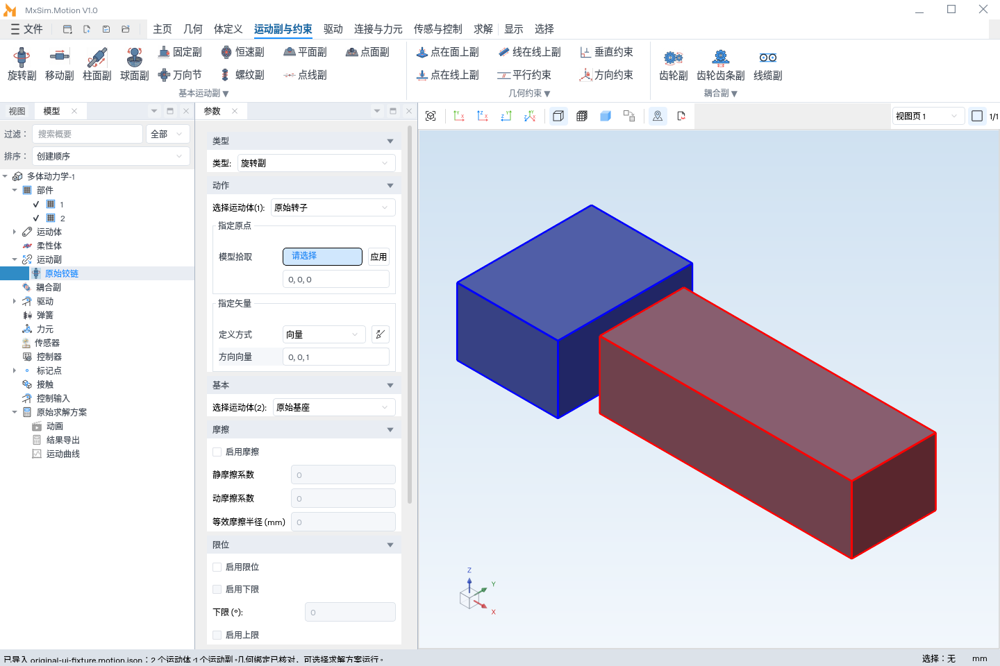

# MxMotion — OCC / OpenGL / Netgen / MotionEngine

这是 `MxSim.Motion` 的 OCC 构建。它沿用原有 Qt Widgets 标题栏、Ribbon、图标、模型树分组和 Qt ADS 停靠布局。原来的 `GUI/`、`ModelData/` 仍保留；根目录的 CMake 只构建不使用 CGM 的配置，不会尝试加载原版私有 SDK。

## 原 GUI 界面基准

多体界面以用户原上传的 `RebuildGUI-wzq_Mech` / `RebuildModelData-wzq_Mech` 源码为准。当前 OCC 构建直接编译原 `mMotion*Panel`、点与方向复合拾取控件、原动画和曲线窗口；菜单结构、模型树与资源图标沿用原 GUI。几何、网格、渲染、绘图和求解通过 `GUI/src/MxMotionOcc/compat/` 接回原调用接口。后续修改应继续修复这些接口，保留原控件及操作流程。

左下角坐标系采用 `wzqlalala/Motion` 固定提交中的导航几何及交互。原菜单入口的恢复与后端能力分别记录；高级 CAD 构造/编辑、结构侧自动生成静力模型、外部 MNF 工具等剩余范围见[原 GUI 恢复与兼容层说明](docs/original-gui-compatibility.md)。该文档包含原 ZIP 哈希、真实桌面截图、接口对应关系及可复跑的验证入口。



## Windows x64 构建和运行

需要 Windows 10/11、MSVC x64（VS 2019/2022 Build Tools，包含 Windows SDK）、CMake 3.21+、Ninja、Qt **5.15** MSVC x64（Widgets、Svg），以及以下 **Release x64** SDK：

- **OpenCASCADE 7.8.1**：指定包含 `include/opencascade`、`lib`、`bin` 的根目录。其 `bin` 需包含 OCCT 的运行依赖 DLL。
- **Netgen 6.2.2505**：用 `USE_OCC=ON` 编译，需 `include/nglib_occ.h`、`lib/nglib.lib` 和 `bin/nglib.dll`（以及依赖 DLL）。网格进程单独运行，不使用 GUI 的 VTK/OSG 或 Chrono。
- **Qt Advanced Docking System 4.4.1**：CMake 默认从[官方仓库](https://github.com/githubuser0xFFFF/Qt-Advanced-Docking-System)拉取并锁定提交 `258340842056271ec207f9b112ac5efc45d9b5f5`，构建为独立 DLL；离线构建可把 `MX_QTADS_SOURCE_DIR` 指向该版本的源码目录。

在 **x64 Native Tools Command Prompt** 中运行下列命令。路径以开发机示例为准，可换成自己的 SDK 目录。没有打开 Native Tools 时，也可以设置 `MX_VCVARS64` 为 `vcvars64.bat` 的完整路径。

```bat
git submodule update --init --recursive
set "MX_QT_ROOT=D:\Qt\5.15.2\msvc2019_64"
set "MX_OCCT_ROOT=E:\codex\Motion\output\occt-7.8.1\Library"
set "MX_NETGEN_ROOT=E:\codex\Motion\output\netgen-sdk"
tools\build-occ.cmd
build-occ\bin\MxMotion.exe
```

脚本配置 Release，从锁定的子模块构建 MotionEngine 核心与 Modal 模块，并下载、校验 Qwt 6.2.0 官方源码，以当前 Qt x64 工具链构建共享库。最终部署 Qt、ADS、OCCT、Netgen、MotionEngine 和 Qwt DLL，并运行 CTest。也可用 `MX_QWT_ROOT` 指定已编译的匹配 Qwt 6.2.0 SDK；用 `MX_MOTIONENGINE_BUILD_DIR` 指定同工具链、同子模块版本的 Release Ninja 构建目录，该目录必须同时包含核心和 `MotionEngine_modal` 库。`MX_BUILD_DIR` 和 `MX_BUILD_JOBS` 可覆盖默认 `build-occ` 和并行度。运行时请保留整个 `bin` 目录（含 `mMainWidgets.rcc`、`platforms/qwindows.dll` 和 `MxMotionMeshWorker.exe`）；另一台机器需预装对应的 Microsoft Visual C++ x64 Redistributable，并有支持桌面 OpenGL 3.3 的显卡驱动。

默认测试不需要桌面。要验证 Qt/ADS、OpenGL、网格、求解与 Qwt，请在可用桌面的会话里设置 `MX_TEST_DESKTOP=ON` 再运行脚本（直接使用 CMake 时设 `-DMX_TEST_DESKTOP=ON`）。原刚体流程的日志和图片保存在构建目录的 `desktop-smoke/`；原始 Motion JSON 导入、新力元编辑、完整求解与动画曲线回归保存在 `native-desktop-smoke/`。不构建桌面版、只测试 CAD/网格/运动求解后端可设 `-DMX_BUILD_GUI=OFF`。

## Linux / 云端构建与验证

同一套 OCC 界面现在支持 Linux x64；使用仓库锁定的 MotionEngine，并链接真实 OCCT、Netgen 和 Qwt。Windows/MSVC 构建方式保持不变。已验证的 Linux 依赖组合为 Debian 13、GCC 14、Qt 5.15.15、OCCT 7.8.1、Netgen 6.2.2501、Qwt 6.1.4 与锁定版本的 Qt ADS。

Debian 13 安装依赖后执行：

```sh
sudo apt-get update
sudo apt-get install git ca-certificates cmake ninja-build g++ qtbase5-dev qtbase5-private-dev libqt5svg5-dev \
    libqt5opengl5-dev libocct-data-exchange-dev libnglib-dev libqwt-qt5-dev \
    libxcb1-dev libx11-dev xvfb xauth libgl1-mesa-dri fonts-noto-cjk
git submodule update --init --recursive
MX_TEST_DESKTOP=ON tools/build-occ.sh
```

构建完成后，在本机或远程桌面会话中运行 `build-occ/bin/MxMotion`。

`motionengine` 子模块需要当前 GitHub 账号对该仓库有读取权限。缺少子模块时构建会报错，不会换成示例数据或虚拟求解器。非系统 SDK 可通过 `CMAKE_PREFIX_PATH` 或 `-DMX_OCCT_ROOT=...`、`-DMX_NETGEN_ROOT=...`、`-DMX_QWT_ROOT=...` 指定。

无桌面的服务器设置 `MX_TEST_DESKTOP=ON` 时，脚本通过 Xvfb 和 Mesa 软件 OpenGL 运行真实窗口测试；测试截图和报告在 `build-occ/desktop-smoke/` 与 `build-occ/native-desktop-smoke/`。这用于验证界面及动画、曲线交互，不代表服务器软件渲染的性能等同于本机显卡。`MX_BUILD_DIR` 与 `MX_BUILD_JOBS` 可覆盖构建目录和并行度。

Linux 构建仅在构建目录内复制并适配锁定引擎的编译兼容性（MSVC 编译参数、非 Windows 计时器的标准库名称等），具体变更见 `cmake/PrepareMotionEngine.cmake`；不修改子模块源码，也不改变求解模型或算法。Qt ADS 4.4.1 的全局焦点回调补上 QObject 生命周期绑定，防止关闭一个主窗口后再打开菜单时访问已销毁窗口；修复同样只编译构建目录副本，见 `cmake/PatchQtAdsLifetime.cmake`。

## 操作

- **主页 → 导入几何模型**，或右击模型树的 **部件 → 导入**。支持 STEP、IGES、BREP。长度统一以毫米显示，BREP 文件本身不含单位，本构建按毫米解释。STEP 保留装配实例、原零件名称与放置位置。
- **打开／保存**使用 `.mxmotion`。V3 内嵌标准 STEP 几何、AutoFlex 求解网格和导入的 MNF，可将单个工程文件复制到安装了新版 MxMotion 的电脑。零件 ID、装配位姿和运动定义单独保存，曲线、曲面约束通过几何特征恢复拾取。V1 和 V2 仍可打开，重新保存时会打包能找到的 MNF 和外部体网格。普通部件的显示网格和求解结果由程序重新生成。原生 `.mxcae` 不在此构建的文件格式范围内。
- **文件 → 导入 → 运动数据**：打开带 STEP 相对路径的 `.motion.json` 时，自动读取关联 STEP、核对 SHA-256，并恢复运动体和边面绑定。旧版 JSON 可继续与已导入的 CAD 一起使用。空白场景只有一个同目录 STEP 时会尝试绑定，存在多个文件时可手动指定。运动体允许绑定多个装配实例，旧标识的恢复按实例名、质量属性和真实边面几何核对。
- **几何 → 实体**：创建立方体（可分别输入三个尺寸）、圆柱体、球体。
- 视口左键拖动旋转、中键或右键平移、滚轮缩放；左键点选部件与模型树同步。**自适应视图**（`F`）用于适配模型。
- **点与方向拾取**：原点、作用点、轴向等字段可选择真实 CAD 顶点、边、面、实体质心，或真实 FEM 节点、网格边、网格面及单元。方向支持两点、几何轴/法向、全局轴及反向；点线/点面副直接保存被选中的 OCC 拓扑与几何特征。右键撤回、Esc 结束当前拾取并保留已选数据，Ctrl + 左键拖动贯穿框选节点；字段拾取期间不会触发整部件切换。保存重开保留选择及反向状态。
- 右击树中的具体部件 → **生成网格**，在 **参数** 区选三角形面网格或四面体体网格、设置单元尺寸，然后点 **生成**。四面体需要适合体划分的闭合几何。单次网格上限为 4,000 节点、每种单元 20,000 个；超限时请增大单元尺寸。网格模式显示实际有限元网格；CAD 轮廓/线框使用单独的 OCC 展示数据。部件右键可导出 `.vtk`；体网格导出四面体，面网格导出三角形。网格不会随 CAD 文件保存。
- 可通过 **文件 → 打开** 加载 `examples/` 中内嵌精确 CAD 的验证工程。自己的模型走 **体定义 → 运动体** → **运动副与约束** → **驱动** → **新建求解方案／求解**。从空模型新建运动体直接使用原生模型：默认钢密度 `7.85e-6 kg/mm³`，按绑定的真实闭合 CAD 自动计算质量、全局质心和完整惯量；可改密度、重新计算或启用自定义质量属性。导入的质量属性不会自动被默认钢替换。几何与线位移用 mm，旋转用 °，时间用 s；原生方案重力为 mm/s²，旧轻量示例重力为 m/s²。求解完成后选择方案下的「动画／结果导出／运动曲线」。
- **完整原生模型编辑**：模型树双击原对象，或使用原 Ribbon 的运动副、耦合副、驱动、连接与力元、传感与控制命令。选择高级对象时，已有轻量刚体模型会保留几何与已有设置并转入完整模型。原生求解方案重力字段沿用原 JSON 的 **mm/s²**；力为 **N**，力矩为 **N·mm**，质量为 **kg**，惯量为 **kg·mm²**。字段标签显示实际单位。
- **函数编辑器**：驱动支持公式及表格，力元公式字段支持各自实际的时间或 `x/v` 状态变量；预览使用同一 MotionEngine 解析器。公式通过校验后写回原字段，支持模板与表格 CSV/TXT 交换。力元没有时间表格字段时不会显示无效的表格选项。
- **驱动 → 运动体驱动**：选择目标刚体、大地或参考体和初始世界安装点。单轴支持位移、线速度、转角和角速度，可选择是否约束另外五个自由度。六自由度位姿驱动支持相对初始安装帧的 X/Y/Z 位移与内禀 XYZ 转角，每个分量可用常数、时间表达式或表格。工程及运动 JSON 会保存这些定义，运动曲线的「运动体驱动」来源提供实际运动及驱动力/力矩。此功能需要支持 BodyDrive 的 MotionEngine。使用独立引擎构建时，请将 MX_MOTIONENGINE_SOURCE_DIR 和 MX_MOTIONENGINE_BUILD_DIR 一起指向匹配的源码和 Release 构建目录。
- **连接与力元 → 柔性连接 → 止挡／只拉绳索**：填写两端运动体及初始全局作用点，设置止挡方向/上下侧/刚度/阻尼，或绳索自由长度/刚度/阻尼/接合宽度。止挡支持幂律与表格；绳索松弛时不施力、卸载不产生推力。原双向线缆位移耦合继续放在耦合副中，两者模型含义不同。
- **自动柔性体**：共用参考体模式沿用真实 Modal 模态缩减；新增独立接口模式使用共回转 tetra4 全有限元，各端口通过真实网格传力、传矩，原刚体质量由网格质量替换。使用原有 OCC/Netgen 网格流程，动画显示真实节点位移。旧 JSON 仅有材料 ID、没有材料数据库时，需要在参数区核对并补齐材料 E、ν、ρ。原节点 ID 形式的附着点也须有相应网格节点映射；缺少数据会指出具体缺项。
- **真实模态检查器**：保存自动柔性体参数后，在其面板直接检查真实频率、振型及附着节点；可切换振型、播放相位、调整显示幅值并导出原始振型 CSV，不必先运行一段动力学。固定接口模态与自由体模态标明各自边界条件，实际保留阶数按真实特征解显示。
- **静力与预载**：求解方案新增静力平衡和预载后动力学。静力按真实力平衡及约束残差验收，输出一个平衡帧；预载后动力学保留该状态中的实际柔性应变。不收敛或不存在平衡时明确失败并保留已有结果。
- **执行器与专用面板**：驱动新增力（N）和力矩（N·mm），支持幅值、功率及空载速度限制，可接入带抗饱和的 PID。求解方案、传感器和 PID 使用分组及联动面板，显示生效设置、匹配变量和各量单位。完整操作、输入约定和边界见[分析工作流](docs/native-analysis-workflow.md)。
- **运动曲线**：在参数栏选择源类型、对象、变量分量及名称，点击 **添加曲线**。支持多曲线、颜色、显隐、删除、时间范围与可见曲线 CSV/TXT 导出；配置按方案随项目和运动 JSON 保存。原生通道按“对象集合 + 稳定 ID + 变量”定位，支持体、运动副、驱动、各力元、传感器、PID 与模态结果，以及实际存在的全部分量。质心位置是世界坐标，位移增量相对第一帧；关节标量明确区分相对转角/行程及其速度。没有结果的通道不会用演示数值代替。
- **动画**：在参数列中使用独立的播放、暂停、停止、倍速与循环控制，滑条对应真实采样帧。停止回到第一帧；关闭动画、选择其他建模内容或切回参数标签时，恢复 CAD 初始位置。只有进入动画并启用对应开关时，曲线时间标记及点击曲线跳转才生效；两个开关可分别控制。
- **柔性云图与载荷导出**：动画可显示弹性位移、总位移及原自由基投影，支持当前帧或全时程范围；原自由基投影是旧算法近似，不是应力或导入的自由模态。方案下「结果导出」支持全部结果 CSV、I/J 端手动载荷 CSV/BDF、特征工况和同步工况；力矩按实际目标点换算。结构侧载荷导入、RBE3 和隐式求解尚不在此构建中。
- **可打开的验证项目**：[native-forces.mxmotion](examples/native-forces.mxmotion) 包含原格式模型、止挡、只拉绳索、体点弹簧与四条曲线请求；[rigid_results.mxmotion](examples/rigid_results.mxmotion) 包含偏置斜轴旋转与三条曲线请求。新增 [native-modal-inspector.mxmotion](examples/native-modal-inspector.mxmotion) 可直接检查 4 阶真实模态，[native-independent-beam.mxmotion](examples/native-independent-beam.mxmotion) 可求解双端独立接口梁的静力伸长。项目均内嵌精确 CAD，操作步骤与应有结果见 [examples/README.md](examples/README.md)。
- **导出运动 JSON**保留原运动字段、未知扩展和当前曲线请求，并导出带实例标识的配套 STEP。在 JSON 中记录相对路径、校验值和几何绑定。MNF 或外部体网格如果位于导出目录之外，会复制到旁边的附件目录。共享算例时一起复制 JSON、STEP 和附件目录。
- 本构建不带 CGM／专有 CAD 转换及完整草图/特征系统。原线程未完成实际接入的 `Line`、`Centripetal`、通用 `Coupling`、裸 `Gear` 运动副和加速度驱动明确报错；齿轮传动使用已有真实实现的齿轮耦合副。引擎未实现的求解器选择也会报错，不会静默换成另一求解器。支持范围和原线程差异见[原生模型接入说明](docs/native-motion-backend.md)。

## motionengine 子模块

```bat
git submodule update --init --recursive
```

子模块使用本分支记录的 `dev` 提交，可用 `git ls-tree HEAD motionengine` 查看准确版本。根目录同时构建并部署 MotionEngine 核心与 Modal 动态库，原生模型的刚柔耦合入口使用 Modal 的 FlexBodyBuilder。本轮引擎增加全有限元接口构建，并修正固定接口模态求解：使用真实自由坐标质量/刚度及特征残差，不再用极小虚拟质量或补零振型凑齐阶数。完整 GUI 的既有接入点在 `GUI/cmake/FindMotionEngine.cmake`：用匹配的工具链将引擎核心及 Modal 模块构建并安装，再用 `-DMotionEngine_SDK_DIR=...` 指向安装目录。完整构建另需 Basic、RebuildGeometry、Render、Mesh 等 SDK 和组织内部的授权配置。含内嵌密钥/凭据的原版授权与登录源码不作为此快照发布物。

## 源码

- `GUI/src/MxMotionOcc/`：在原界面框架中挂接可用命令、渲染与网格进程；直接编译 `GUI/src/Common/` 的原公共组件，沿用 `GUI/resource/`。
- `ModelData/src/MotionOcc/`：OCC 几何、Netgen 网格与 VTK、刚体模型与 MotionEngine 适配、项目与 CSV。CAD／显示／网格实现沿用同机 `Motion` 项目的对应实现思路，未引入供体主窗口或 Chrono。
- `tests/MotionOccBackendSmoke.cpp`：几何读写、错误回退和实际网格的自动测试。
- `tests/MotionOccRigidSmoke.cpp` 和桌面测试：核对 MotionEngine 的真实运动时程以及播放与 Qwt 联动。
- `tests/MotionOccPlaybackSmoke.cpp`、`MotionOccCurveSmoke.cpp`、`MotionOccPlotSmoke.cpp`：动画坐标和编号、曲线数值语义，以及按方案配置曲线的实际交互回归。
- `tests/MotionOccNativeDocumentSmoke.cpp`、`MotionOccNativeProjectSmoke.cpp`、`MotionOccNativeTopologySmoke.cpp`：原文档完整往返、几何绑定与实际边面选择验证。
- `tests/MotionOccNativeSmoke.cpp`：真实 MotionEngine 全功能数值回归；`MotionOccNativeCases.cpp`：原 CAD + JSON 的完整时长批量验证；`MotionOccOriginalGuiSmoke.cpp`：原 GUI 窗口内导入、原复合拾取、编辑、保存、真实求解与动画曲线；同一入口继续运行原 AutoFlex 和模型树回归。
- `tests/MotionOccOriginalNativeCurvesSmoke.cpp`、`MotionOccOriginalLoadExportSmoke.cpp`：通过原曲线控件验证止挡/只拉绳索等真实通道、保存重开与再次求解；通过原载荷导出三个页面验证真实节点拾取、逐帧力矩转换、工况 JSON 及单帧静力 CSV/BDF。最新 [21 项非视口回归](docs/verification/original-headless.txt)与 [9 项真实桌面回归](docs/verification/original-desktop.txt)的范围和剩余边界见[原 GUI 兼容说明](docs/original-gui-compatibility.md)。
- [原界面逻辑对照与云端验证](docs/lite-occ-restoration-review.md)：修复依据、行为差异、测试范围及完整 SDK 的剩余边界。
- [原运动数据工作流与验证](docs/native-motion-workflow.md)：导入步骤、复测命令及算例结果说明。
- [可公开复测的原生运动回归](docs/native-motion-verification.md)：云端构建、自动测试、窗口流程及自生成验证项目。
- [原求解器兼容核对](docs/native-solver-compatibility-audit.md)：柔性结果、原点参考系、有效结果截尾、载荷符号与接触/PID 回归，以及原代码和当前构建的明确边界。
- [真实模态、独立接口、静力预载与受限执行器](docs/native-analysis-workflow.md)：新增能力的操作路径、模型含义、单位和验证入口。
- [新增分析能力的验证记录](docs/native-analysis-verification.md)：独立接口解析柔度、真实模态、静力预载与执行器数值验证，以及实际窗口流程。
