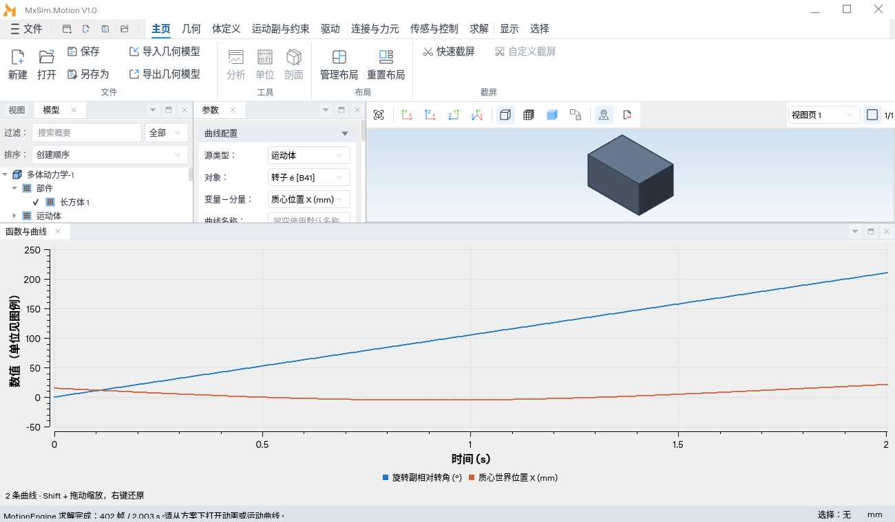
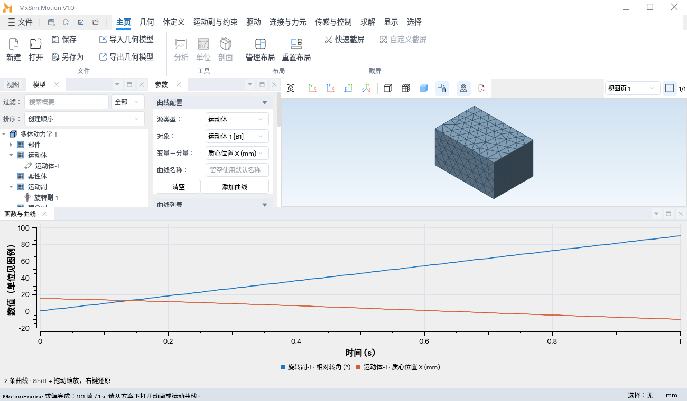
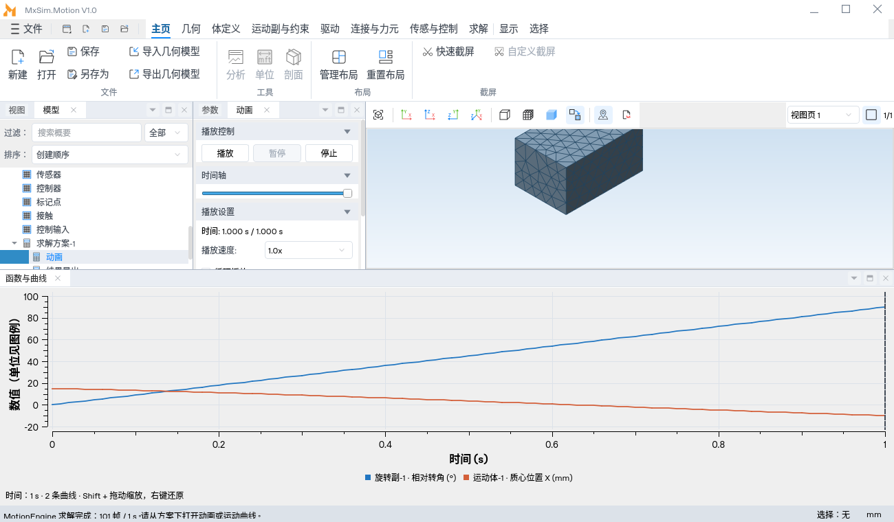

# lite-occ 原界面逻辑对照与云端验证

本页记录 **2026-11-20 首轮动画/曲线恢复阶段** 的基线、测试和截图。后续已接通原格式 JSON、完整原生求解适配、AutoFlex、拾取、函数编辑与载荷导出，当前能力和测试结果请看 [原运动工作流](native-motion-workflow.md)、[当前验证记录](native-motion-verification.md) 及 [求解器兼容核对](native-solver-compatibility-audit.md)。本页的旧引擎版本和六项测试属于当时的记录。

## 对照基线

- 修复前分支提交：`bd0ef4eb74fa35e28cf737de83f83f8b6a390ff8`。
- 原始输入：`RebuildGUI-wzq_Mech.zip` 与 `RebuildModelData-wzq_Mech.zip`。
- 完整文件对比：GUI 有 2,894 个原文件逐字节一致，没有被改写的原文件；省略项主要为文档、缓存、部分测试以及原授权/登录实现。ModelData 的 613 个原文件全部逐字节一致。
- 实际入口是根 CMake 构建的 `GUI/src/MxMotionOcc/` 与 `ModelData/src/MotionOcc/`，不是原完整 SDK 主程序。原代码留在仓库中并不表示它已经参与运行。
- MotionEngine 保持子模块锁定提交 `fb0a9d76a9d3c40827928e8d9a9662bb77862579`。本次云端使用的全部 5,303 个源文件，均已与该提交的 Git blob SHA 核对一致。

此次修复集中在适配层，并直接复用原 `CommonWidgets/mFoldSection.cpp`。原动画面板、曲线面板、结果查询服务和原 ModelData 类保持不变，便于后续完整 SDK 构建继续使用。

主要对照入口为原 [mMotionAnimationPanel.cpp](../GUI/src/MainWindow/mMotionAnimationPanel.cpp)、[mMotionCurvePanel.cpp](../GUI/src/MainWindow/mMotionCurvePanel.cpp)、[mMotionResultQueryService.cpp](../GUI/src/MainWindow/mMotionResultQueryService.cpp) 和 [mDockLayoutManager.cpp](../GUI/src/GUIFoundation/mDockLayoutManager.cpp)；对应修复在 [RigidMotionUi.cpp](../GUI/src/MxMotionOcc/RigidMotionUi.cpp)、[RigidPlayback.h](../GUI/src/MxMotionOcc/RigidPlayback.h)、[RigidPlot.cpp](../GUI/src/MxMotionOcc/RigidPlot.cpp) 和 [RigidResultSeries.cpp](../GUI/src/MxMotionOcc/RigidResultSeries.cpp)。

## 主要偏差与修复

| 内容 | 原逻辑与问题 | 修复后行为 |
| --- | --- | --- |
| 求解完成 | 原版由用户选择查看结果；适配层自动打开图和动画 | 完成求解只更新方案结果状态，用户从树节点进入动画或曲线 |
| 动画参数位置 | 原版使用共享参数区域；适配层另设简化底部控制条 | 参数列中的动画页，使用原折叠控件并支持滚动 |
| 播放状态 | 简化实现把播放/暂停混为一键，缺少停止和退出会话语义 | 独立播放、暂停、停止；0.5/1/2/5/50 倍速；循环；停止回第一帧，退出还原原始 CAD |
| 时间轴 | 固定 10,000 个刻度映射总时长，弱化真实帧含义 | 滑条为实际结果帧索引，播放按真实采样时间插值，支持非等间隔和非零起始时间 |
| 运动体映射 | 按输入/结果数组下标配对，容易因顺序变化串体 | 按 `bodyId` 查询结果，再按 `partId` 作用于几何；缺失或重复编号直接报错 |
| 几何位姿 | 初始 CAD 已是全局坐标，质心补偿不能重复应用 | 使用 `T(当前全局质心) * R(当前姿态) * T(-初始全局质心)`；旋转采用四元数球面插值 |
| 动画与曲线 | 适配层把标记、点击跳转始终绑定 | 原版两个独立开关；仅动画会话有效，退出、切回参数页或选择结果导出时即停用 |
| 曲线配置 | 原版是按方案保存的请求列表；适配层只有一个自动切换通道 | 参数栏明确选择源类型、对象、变量分量、名称，再点击添加；支持多曲线、颜色、显隐、删除、清空 |
| 数据语义 | 绝对位置缺失，“关节位置”混淆全局位置与标量坐标 | 区分质心世界位置与相对初始帧的位移增量；关节标量明确命名为相对转角/行程及其速度 |
| 曲线取数 | 隐式依赖数组顺序，异常点可能被跳过 | 使用实体 ID 和实际时间序列；缺失、重复、非有限数据及非法时间轴不会被静默连线 |
| 曲线持久化 | 显示配置只存在临时控件中 | `RigidScenario.curveRequests` 保存方案的请求；项目可读旧文件，显示配置修改不清除求解结果 |
| 已保存曲线首次显示 | ADS 临时禁用祖先重绘时，Qwt 图例标签可能固化继承的禁用状态 | 保留标签原先的显式重绘状态，使首次打开已保存结果配置时名称、颜色与单位正常绘制 |
| 方案切换 | 旧控件的延迟显隐/删除回调可能作用于新方案同编号曲线 | 回调核对创建它的结果对象；方案切换重建目标方案曲线 |
| 曲线导出 | 缺少按配置曲线导出的完整流程 | 时间范围、可见曲线和 CSV 使用同一组真实数据，支持间隔取样并保留末点，原子保存 |
| 小窗口显示 | 底部图被停靠控件的默认滚动容器裁切，窄参数栏控件溢出 | 图随停靠区域缩放，参数面板可纵向滚动，按钮和名称适配窄列，初始主窗口不超过可用屏幕 |
| 模型树 | 每次刷新重新展开树，搜索只处理部件 | 保留现有折叠状态，搜索覆盖方案和其他节点 |
| 云端构建 | 入口仅允许 Windows/MSVC，路径硬编码 `.exe/.dll/.lib` | 增加 Linux CMake/脚本分支，保留 Windows 构建和部署流程 |

### 量的定义

世界位置使用毫米，线速度使用毫米/秒；角度使用度，角速度使用度/秒。位移增量为当前质心位置减去该运动体第一帧质心位置。欧拉角沿用原界面的 Qt 转换约定，并处理跨 ±180° 的分量跳变；它仍是欧拉角，不等同于任意轴的累计转角。需要连续关节转角时，应选择旋转副的相对转角。

首轮轻量适配后端没有输出的加速度、反力、标记点和传感器结果不会用零值或派生演示数据冒充；后续原生求解适配已接入这些实际通道。原版运动副节点 I 的世界位置也不与标量关节坐标混称。

## 验证内容

| 测试 | 关注点 |
| --- | --- |
| `MotionOcc.CadMesh` | 实体创建、STEP/IGES/BREP 交换、错误回退、真实 Netgen 面网格与体网格 |
| `MotionOcc.Rigid` | 真实 MotionEngine 的偏置斜轴旋转、移动副、固定副、质量惯量、取消、项目往返和 CSV；新增按方案曲线配置持久化与非法引用保护 |
| `MotionOcc.Playback` | 非零起点、非等间隔帧、结果顺序变化、质心/四元数变换、单帧、异常时间轴、缺失编号及浮点渲染范围 |
| `MotionOcc.Curves` | 世界位置与位移区别、真实时间、单位、角度跳变、缺失/重复/非有限数据 |
| `MotionOcc.Plot` | 真实 Qwt 控件的显式添加、多曲线、显隐、时间过滤、CSV、方案隔离、旧控件延迟事件、图例重绘状态、窄列操作控件与清空 |
| `MotionOcc.Desktop` | 整个 Qt/ADS/OpenGL 窗口中导入、拾取、网格、建体/运动副/驱动/方案、求解、已保存曲线首次显示、播放/暂停/停止、点击联动、退出与标签切换/导出节点恢复 |

云端使用 Debian 13 / GCC 14 / Qt 5.15.15 / OCCT 7.8.1 / Netgen 6.2.2501 / Qwt 6.1.4 / Qt ADS 4.4.1。Windows 仍使用现有 Qt 5.15 / Qwt 6.2.0 / MSVC x64 配置。本次没有在 Windows 主机重新执行 MSVC 编译。

2026-11-20 在同一云端桌面执行完整 CTest，以上 **6 项全部通过**。桌面回归使用真实 OpenGL 4.5 Core、真实 MotionEngine 求解、真实 Netgen 网格和 Qwt 曲线。另在实际窗口中打开并求解下述示例，检查了已保存曲线配置的首次显示及点击曲线后几何姿态、滑条和时间标记的一致性。

以下图片来自自动桌面回归实际运行的 Qt 窗口，未绘制替代界面：







## 复现

构建依赖、Windows 命令与 Linux 命令见根目录 [README](../README.md)。已有构建可运行：

```sh
ctest --test-dir build-occ --output-on-failure -E Desktop
# 桌面测试需要配置时启用 -DMX_TEST_DESKTOP=ON，并有可用 OpenGL 桌面。
ctest --test-dir build-occ --output-on-failure -R Desktop
```

手动检查的操作顺序：

1. “求解 → 刚体示例 → 求解”。完成后，模型树中方案下的动画、结果导出和运动曲线可用。
2. 进入“运动曲线”，在参数栏选择运动副及相对转角，点击“添加曲线”；再添加质心位置或位移增量。图中应保留两条请求，而不是切换一条。
3. 进入“动画”，拖动时间轴、播放、暂停、停止。分别关闭两个曲线联动开关，确认互不影响。
4. 在非零时刻关闭动画或切回参数标签。几何应回到建模位置，曲线仍保留，时间标记及点击动画跳转停止。
5. 保存项目，重新打开并求解，再打开运动曲线。配置应保留；求解采样和网格仍按既有 `.mxmotion` 格式不写入项目。

仓库还提供可直接打开的 [偏置斜轴旋转项目](../examples/rigid_results.mxmotion) 与 [操作说明](../examples/README.md)。它包含两条默认可见的曲线和一条默认隐藏的位移增量曲线，用于核对绝对位置与位移、单位、配置持久化和动画联动。

## 阶段边界与后续更新

首轮工作只恢复了刚体、动画和曲线，尚未接通柔性体、接触及高级运动副；这些已经在后续原生求解适配中接入，并有真实引擎回归。原格式 JSON、实际 CAD/Netgen 网格、原拾取交互、AutoFlex 模态结果与云图、函数编辑及多体载荷导出均见当前文档。

完整草图/特征系统、原 `.mxcae` 工程入口、专有 CAD 格式和结构侧 RBE3/隐式求解仍依赖未移植的子系统。当前构建不能被视为完整私有 SDK 产品或原产品任意功能组合均已通过验证。

本次未更换运动学/动力学算法。Linux 对锁定引擎的兼容修改只作用于构建副本，具体替换公开在 `cmake/PrepareMotionEngine.cmake`，原子模块及其固定版本保持不变。
