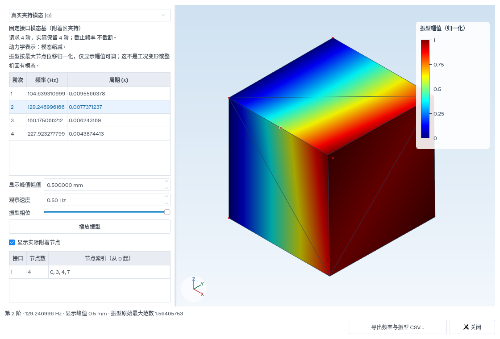
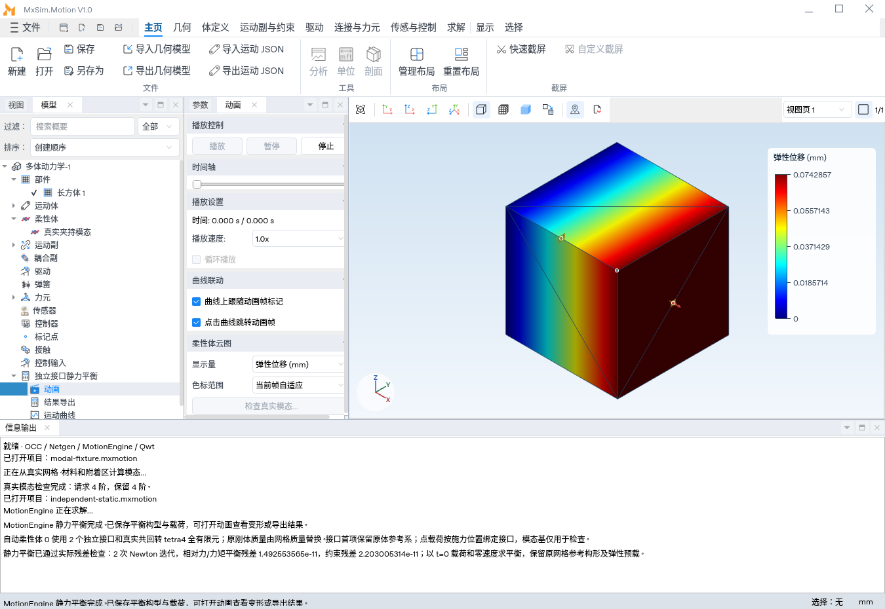
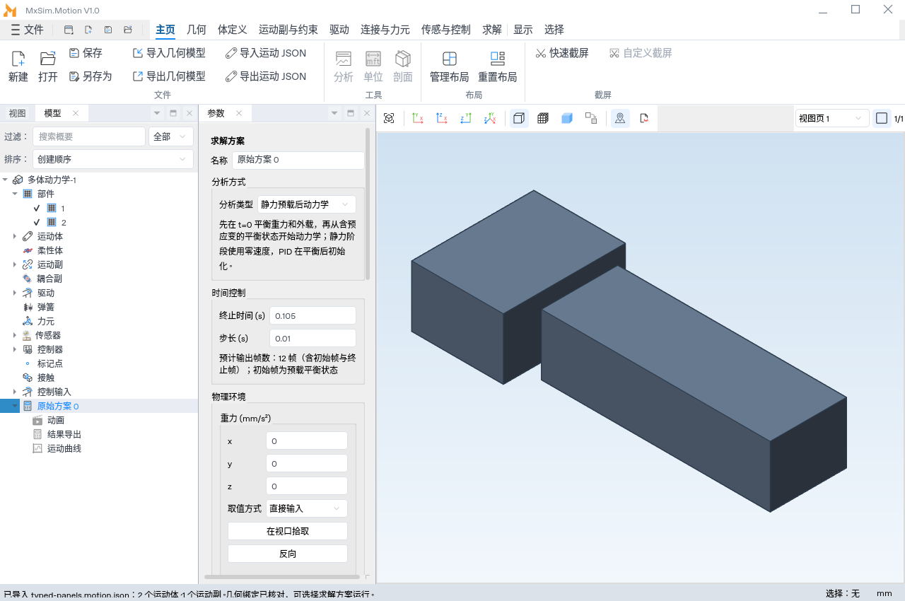
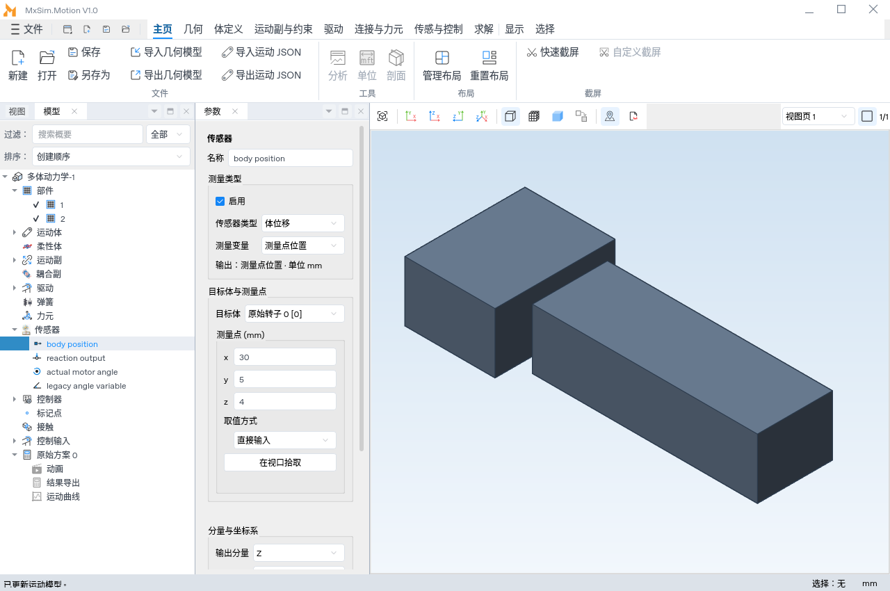
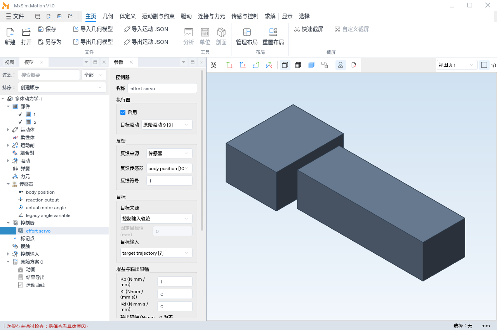

# 新增分析能力的验证记录

本记录对应真实模态检查、独立柔性接口、静力预载、力/力矩执行器，以及求解方案、传感器和 PID 专用面板。操作和输入语义见[分析工作流](native-analysis-workflow.md)，静力与受限执行器的实现约定见[后端说明](native-static-and-servo.md)。

**最终完整构建成功，18/18 非桌面 CTests 通过，4/4 实际桌面入口通过。** 保留的运行记录：[非桌面测试](verification/native-analysis-headless.txt)、[实际窗口测试](verification/native-analysis-desktop.txt)。这次核验的三个引擎变更文件与实际编译副本逐字节一致。

## 环境与方法

使用 Linux x64 云端环境、GCC 14、Qt 5.15.15、OCCT 7.8.1、Netgen 6.2.2501、Qwt 6.1.4 和仓库锁定的 Qt ADS。Core 和 Modal 均由实际 MotionEngine 源码编译。Qt 窗口测试在真实桌面/OpenGL 会话执行；本轮未在 Windows 实机复测。

对应引擎提交：[17a5c6e](https://github.com/wzqlalala/motionengine/commit/17a5c6e53219b297d15123cb2178c3ee51b4f928)。GUI 同步锁定该 gitlink，拉取后应执行 `git submodule update --init --recursive`。

新增代码沿用现有文档、CAD 绑定、参数区和结果时间轴。独立接口动力学采用实际共回转 tetra4 全有限元；原共用参考体的缩减路径保留。模态检查使用真实质量/刚度及边界条件得到的特征向量，显示归一化不改写原始基。

## 数值依据

### 独立接口与柔性变形

[IndependentFlex](../tests/MotionOccIndependentFlexSmoke.cpp) 使用自生成长方体 CAD 和真实四面体网格。40 × 10 × 10 mm 梁的两端分别连接固定接口及沿梁轴可滑动的独立接口，E = 100 MPa、ν = 0，轴向力 10 N。

| 检查 | 观测与断言 |
| --- | --- |
| 轴向柔度 | 端部伸长 **0.04 mm**，符合 `FL/(EA)`；同时检查内部节点的线性轴向位移 |
| 质量只计一次 | 原刚体自定义质量为 41 kg；柔性求解实际使用 **4 kg** 网格质量，支承侧合反力为 **−39.24 N**，与网格重力一致 |
| 预载保持 | 从平衡态继续动力学，21 帧保持原有 0.04 mm 伸长，没有把变形网格重设成无应力构形 |
| 零内部夹持模态 | 8 节点全部属于两个端面接口时，仍通过全有限元得到真实弹性响应，不依赖虚构模态坐标 |
| 端口传矩 | 右端旋转接口施加 **0.1 N·mm**，相对扭转约 **1.01035 × 10⁻⁵ rad**，支承反力矩合计 0.1 N·mm；检查实际端面节点随接口转动、固定端保持不动 |
| 刚体旋转客观性 | 全网格施加 1.2 rad 纯刚体转动，最大内力约 **1.46 × 10⁻⁹ mN** |
| 稀疏静力 | 312 个速度自由度系统仍得到 0.04 mm 解析伸长，使用实际稀疏刚度和约束块 |
| 稀疏模态 | 1224 个自由节点坐标进入稀疏特征求解，首阶频率约 **62.6 Hz**；最大相对特征残差 **3.99 × 10⁻⁸**，低于测试阈值 10⁻⁷ |
| 自由体检查 | 单独自由体检查保留 8 个真实模态；没有真实附着关系的动态柔性模型明确拒绝 |

这些数值是仓库内合成模型的验证值。端面刚性附着、网格密度和材料参数均会影响其他工况的刚度与频率；本轮没有把粗 tetra4 网格的扭转响应当作网格收敛后的工程精度结论。

### 真实模态与显示

[Modes](../tests/MotionOccModesSmoke.cpp) 检查真实夹持特征解的数量、排序、截止频率和附件节点：

- E 增大为 4 倍，频率增大为 2 倍；ρ 增大为 4 倍，频率降为一半。
- 固定接口节点的振型分量为零；没有通过极小虚拟质量或补零列凑阶。
- 共用参考体缩减需要至少 3 个非共线附着节点；单节点欠约束附着作为明确失败用例保留，另用足够的真实自动附着区验证成功求解。
- 正负显示相位产生相反位移，零相位返回参考网格；预览不改变原始基。
- CSV 包含频率、参考坐标、原始振型及归一化分量；导出失败不覆盖已有文件。
- 全有限元弹性位移移除接口刚体运动，保留独立端口间的变形和初始预载。

模态桌面模型是 10 mm 立方体、8 节点/5 四面体、E = 100 MPa、ν = 0.3、ρ = 0.001 kg/mm³，一侧 4 节点夹持。前 4 阶频率约为 **104.6393、129.2470、160.1751、227.9233 Hz**。这是该离散模型的固定接口模态，不是整机工作构型模态。

旧自动网格用例的 3 mm 附着半径实际只覆盖 2 个节点，过去的虚拟质量处理掩盖了欠约束。新版本保留该诊断，正例明确将半径设为 6 mm 后使用真实选中节点；该模型的 123 个自由节点坐标特征残差约为 3.75 × 10⁻¹⁴。测试另保留单节点反例，使失败语义不依赖不同 Netgen 版本的具体选点数量。

### 静力、预载和执行器

[StaticServo](../tests/MotionOccStaticServoSmoke.cpp) 包含 16 个实际求解或故障场景：弹簧 `kx = mg`、扭簧 `T/k`、支承反力、CAD 接触静力及预载、迭代耗尽、取消、无平衡，以及真实力/力矩电机与受限闭环。

1 kg、10 N/mm 竖向弹簧的平衡位移为 −0.981 mm，支承反力为 9.81 N。扭簧案例的静力转角为 10°。预载动力学保留平衡位移与零初始速度，错误或取消不覆盖调用方已有结果。接触静力案例显式使用 `staticTolerance = 1e-4`，匹配碰撞几何精度；求解器没有暗中放宽用户容差。

实际 Force/Torque 电机分别以 `F/m`、`T/I` 检查加速度，同时检查 I/J 载荷符号。执行器的幅值、功率和空载速度包络进入真实求解，制动能力按定义保留。平移/旋转 × 正/负反馈极性共 4 个受限 PID 案例检查收敛和单位。旧速度型 Sensor PID 与刚体 CAD 冲击/沉降测试继续列在全量回归中。

## 实际窗口流程

**ModalDesktop、NativeDesktop、Desktop、Picking 四类实际桌面入口全部通过（4/4）。** 新检查器的频率表、附着节点、色标、相位及导出按钮均已渲染验证；窄参数栏的帮助文字和分组不再相互覆盖。

[ModalDesktop](../tests/MotionOccModalDesktopSmoke.cpp) 在真实窗口中打开保存工程，从柔性体面板发起独立模态求解，检查 4 阶频率、附着节点表、振型切换、正负相位、播放、颜色标尺及 CSV 文件对话框。检查过程不创建虚假动力学结果。

同一入口再打开独立接口静力工程，执行求解，检查结果树、单帧静力状态、实际有限元变形和弹性云图。没有内部夹持模态的全有限元模型不启用虚构的模态结果。





上图静力检查使用另一个 10 mm 立方体、100 N 载荷和 ν = 0.3 的离散模型，云图最大值约 0.0742857 mm；它与前述 40 mm 轴向梁的 0.04 mm 解析柔度检查是不同工况。

[NativeDesktop](../tests/MotionOccNativeDesktopSmoke.cpp) 沿原有“导入 STEP → 导入运动 JSON → 参数编辑 → 保存重开 → 求解 → 曲线/动画/导出”路径，增加三个专用面板及受限执行器的实际控件操作。测试检查未知扩展字段、原 COM 局部测量点、固定/轨迹目标切换和单位。







旧 AutoFlex 窗口流程继续通过：真实 Netgen **70 节点、138 四面体**，材料编辑与附件选择，已保存网格复用，项目重开和 JSON 重导入后求解。采用修正后的真实夹持模态基，本轮该合成悬臂末帧弹性位移最大坐标分量为 **0.36681448 mm**；恢复阶段文档中的 0.54045306 mm 属于旧模态算法记录，不能混作当前结果。原树图标像素、CAD/FEM 拾取、I/J 载荷导出及动画/曲线同步也继续通过。

## 复测入口

```bash
git submodule update --init --recursive
cmake --build build-occ -j3
ctest --test-dir build-occ -LE desktop --output-on-failure -j2
ctest --test-dir build-occ -L desktop --output-on-failure
```

桌面 CTest 需要配置 `-DMX_TEST_DESKTOP=ON` 并在可用桌面或 Xvfb/Mesa 会话运行。也可直接执行：

```bash
build-occ/bin/MxMotion --modal-desktop-smoke build-occ/modal-desktop-smoke
build-occ/bin/MxMotion --native-desktop-smoke build-occ/native-desktop-smoke
```

私有输入不随上述验证记录发布。旧恢复阶段的完整拾取、几何编号、载荷导出及原模型树图标说明见[原生运动回归](native-motion-verification.md)。
