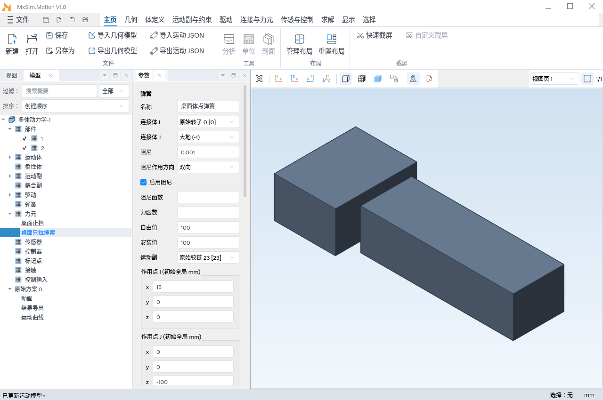
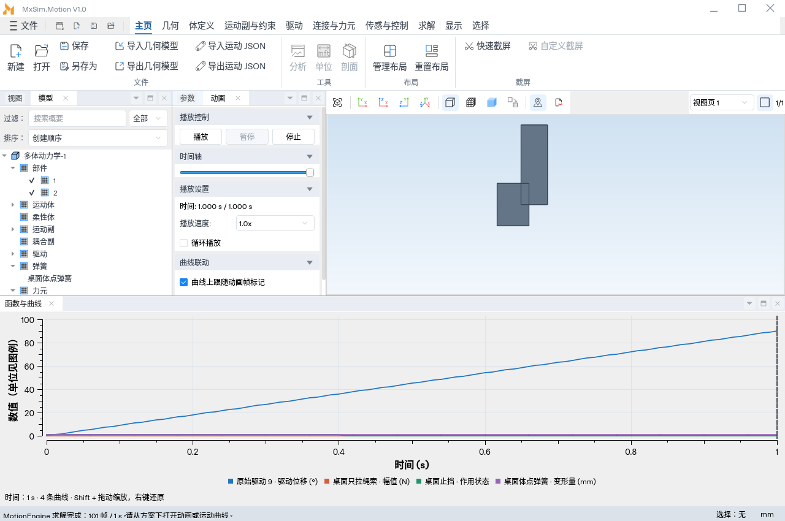

# 可公开复测的原生运动回归

## 云端构建

Linux x64 构建使用 Debian 13 SDK：GCC 14、Qt 5.15.15、OCCT 7.8.1、Netgen 6.2.2501、Qwt 6.1.4，以及仓库锁定的 Qt ADS。

MotionEngine 锁定 `fff3dd3b5caf37a6d01e5ea5c9f89d7be5eafed4`，同时构建真实 Core 和 Modal。引擎源文件与锁定提交核对一致，Linux 编译兼容补丁仅应用于构建目录副本。本轮使用云端原生桌面运行 Qt/OpenGL 窗口；Windows 构建入口保留，本轮没有 Windows 实机测试结果。

## 自动测试结果

**9/9 非桌面 CTests 与 2/2 桌面 CTests 通过。** 下面的测试代码和自生成输入均随仓库提供，可按 [工作流说明](native-motion-workflow.md) 复测。

| 测试 | 主要覆盖 |
| --- | --- |
| NativeDocument / NativeProject | 原格式文档、引用校验、未知字段保留、几何绑定、项目保存往返、惯量约定 |
| NativeTopology | 明确边面引用、所属体校验、唯一几何证据恢复、歧义拒绝 |
| Native | 真实 MotionEngine 约束、耦合、驱动、力元、传感器/PID、接触、Modal/Netgen与新增单边力 |
| CadMesh / Rigid | 精确 CAD、完整显示网格、自动体网格、原轻量模型求解 |
| Playback / Curves / Plot | 稳定对象 ID、质心与位移语义、多部件及模态动画、实际时间轴、曲线分量和 Qwt 配置 |
| Desktop / NativeDesktop | 实际 Qt/OpenGL 窗口中的导入、编辑、保存、求解、曲线、CSV/JSON导出与动画控制 |

物理断言包含单位换算、真实零时刻速度、非整除尾步、长时精确采样、解析惯量与力矩加速度、滚动/滑动差异、单边力方向、初始几何贴合、越界终止和矛盾约束拒绝。具体能力及输入要求见 [原生模型接入说明](native-motion-backend.md)。

## 自生成窗口示例

`NativeDesktop` 创建两个长方体及原格式运动 JSON，再通过真实界面完成：

1. 导入 STEP 和运动 JSON。
2. 新建并编辑独立止挡、只拉绳索和体点弹簧，保存并重新读取项目。
3. 调用真实求解器，添加四条曲线，导出 CSV 和运动 JSON并校验回读。
4. 按实际帧显示 CAD 动画，检查播放、暂停、停止及曲线联动。
5. 删除止挡及它自己的曲线，确认相同 ID 的其他来源仍被保留。

原运动体 ID `0`、非连续 ID、不同的几何 ID 和求解方案 ID `0` 都包含在该自生成测试中。公开项目 [native-forces.mxmotion](../examples/native-forces.mxmotion) 自带精确 CAD 和四条曲线请求，操作及预期数值见 [examples/README.md](../examples/README.md)。

## 自己的模型

可用 `MX_NATIVE_SMOKE_CAD` 和 `MX_NATIVE_SMOKE_MOTION` 指定自己的配套文件，追加窗口工作流检查；批量原时长检查使用 `MotionOccNativeCases`。完整命令见 [原运动数据工作流](native-motion-workflow.md)。

运行时的关节线性验收阈值为 `max(0.05 mm, 1e-4 × 最大初始质心坐标模长)`，方向角阈值为 `0.01°`。批量报告保存每个工况的实际残差、帧数、终时和失败阶段。应依据这些实测值评估所选模型及求解设置的精度。含用户模型明细的报告由调用方单独保留，不随通用回归代码发布。
