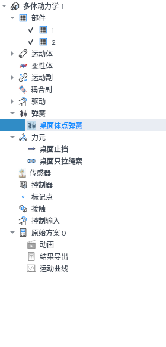
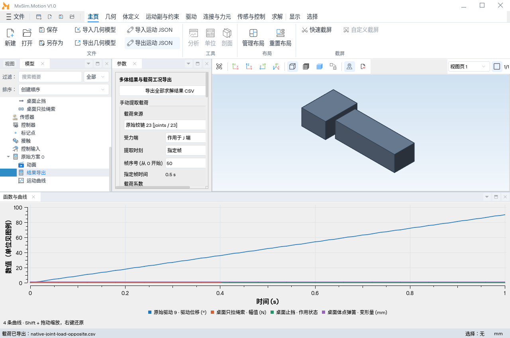
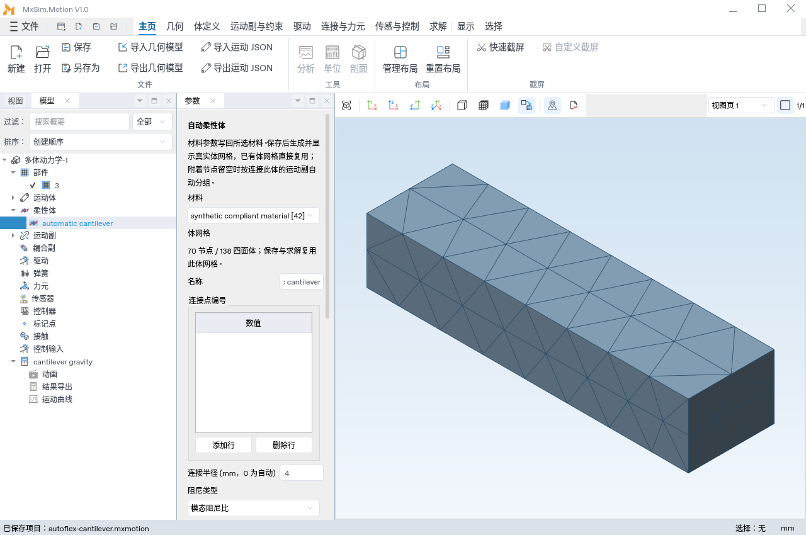
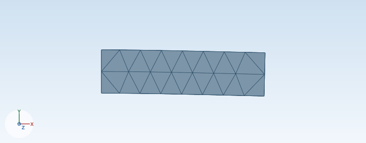
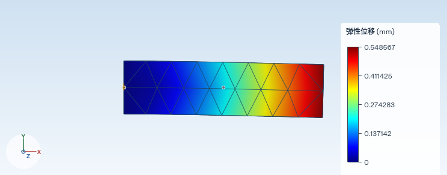

# 可公开复测的原生运动回归

本文记录 GUI 提交 `31c9413`、引擎提交 `fff3dd3` 的界面恢复阶段，包括当时的测试数量、截图和数值。后续真实模态、独立接口、静力预载与受限执行器的实现及复测记录见[分析工作流](native-analysis-workflow.md)和[新增分析验证](native-analysis-verification.md)。下文“本轮”均指该恢复阶段，旧模态位移数值不作为新特征求解器的基准值。

## 云端构建

Linux x64 构建使用 Debian 13 SDK：GCC 14、Qt 5.15.15、OCCT 7.8.1、Netgen 6.2.2501、Qwt 6.1.4，以及仓库锁定的 Qt ADS。

MotionEngine 锁定 `fff3dd3b5caf37a6d01e5ea5c9f89d7be5eafed4`，同时构建真实 Core 和 Modal。引擎源文件与锁定提交核对一致，Linux 编译兼容补丁仅应用于构建目录副本。本轮使用云端原生桌面运行 Qt/OpenGL 窗口；Windows 构建入口保留，本轮没有 Windows 实机测试结果。

## 自动测试结果

**15/15 非桌面 CTests 通过；Desktop、NativeDesktop、Picking 三类桌面测试均通过（3/3）。** 本轮在真实 Qt/OpenGL 窗口中执行了三类桌面入口，NativeDesktop 还带独立提供的输入重复运行，完成求解至实际终止、位移曲线与 CSV、同步动画检查。此处只记录可公开的合成输入、通用行为和测试方法，不发布独立输入的文件、名称、截图或逐例数值。

测试代码和自生成输入均随仓库提供，可按 [工作流说明](native-motion-workflow.md) 复测。

| 测试 | 主要覆盖 |
| --- | --- |
| NativeDocument / NativeProject | 原格式文档、未知字段保留、局部/世界质心的有据绑定、重复件拒绝、项目保存往返、惯量约定 |
| NativeTopology | 真实裁剪边面、全局构造曲线、原编号候选核验、几何特征保存/重绑、错误面与歧义拒绝 |
| Native | 真实 MotionEngine 约束、耦合、驱动、力元、传感器/PID、接触、Modal/Netgen、新增单边力、记录前边界保护 |
| CadMesh / Rigid | 精确 CAD、完整显示网格、自动体网格、原轻量模型求解 |
| Playback / Curves / Plot | 稳定对象 ID、质心与位移语义、多部件/独立构造曲线/模态动画、实际时间轴、曲线分量和 Qwt 配置 |
| NativeMass | 实际 OCC 体积、组合质心、非对角惯量、密度换算、自定义质量与失败时保留原数据 |
| FunctionEditor | 同一引擎解析器、状态变量范围、公式/表格优先级、窄脉冲节点、1025 行表格、CSV/TXT 往返、实际对话框操作和取消 |
| Symbols | 运动体/副/力元/marker/传感器的显示符号、两端独立位姿与传感器局部坐标换算 |
| FlexResults | 完整柔性结果、三类标量、向量先插值、真实悬臂、偏心夹持旋转、发散前同步有效帧 |
| LoadExport | 实际静力 I/J 符号、力矩换点、CSV/BDF、极值/同步工况、分析体初始参考系、错误不覆盖已有文件 |
| NativeDynamics | 四种传感器 PID 闭环、真实 CAD 冲击与静态平衡、步长减半、零接触深度默认、无接触反例 |
| Picking | 真实鼠标事件、CAD/FEM 拓扑及节点 ID、悬停与选择、贯穿框选、Esc、重新进入、云图与色标像素 |
| Desktop / NativeDesktop | 实际窗口中的导入、建模、原字段拾取、自动质量、函数编辑、保存重开、求解、曲线、载荷 CSV/BDF/JSON、树图标、AutoFlex 网格生命周期与云图动画 |

物理断言包含单位换算、真实零时刻速度、非整除尾步、长时精确采样、解析惯量与力矩加速度、滚动/滑动差异、单边力方向、初始几何贴合、越界终止和矛盾约束拒绝。具体能力及输入要求见 [原生模型接入说明](native-motion-backend.md)。

非桌面入口为 `ctest --test-dir build-occ --output-on-failure -LE desktop`。桌面构建启用 `MX_TEST_DESKTOP=ON`，在支持 OpenGL 3.3 的桌面或 Xvfb/Mesa 会话中运行 `ctest --test-dir build-occ --output-on-failure -L desktop`。本轮桌面报告实际初始化了 OpenGL 4.5 core。

## 真实几何与编号恢复

底层保留精确 OCC BRep，边面查询、曲线采样和体网格均来自实际导入的几何。显示网格、求解用几何和拓扑身份分别保存；恢复拓扑时不会用附近实体边替代缺失的构造曲线。

运动体绑定先核对世界坐标质心。对非自定义质量属性，如果 STEP 实例保留了真实 placement，则可将 CAD 质心逆变换到原始局部坐标，并同时核对全部主惯量/质量比；只有唯一候选才恢复绑定。该步骤只识别运动体对应的 CAD，不改写原 JSON 的质量、质心和惯量，也不移动 CAD。自生成装配回归覆盖旋转/平移、打乱导入次序、世界坐标优先、错误质心/惯量、自定义质量属性和相同重复件；保存并重开项目后仍可用原 STEP placement 重新识别。依据见 [NativeDocument](../tests/MotionOccNativeDocumentSmoke.cpp) 与 [NativeProject](../tests/MotionOccNativeProjectSmoke.cpp)。

旧全局几何编号作为候选，不直接等同于 OCC 局部序号。已确认的 STEP 实例顺序、真实裁剪几何、初始贴合及排他证据共同确定边面；共享顶点处的多条实体边、距离相近的候选以及错误对侧面均不能靠数字顺序消歧。确定选择后保存 `geometry` 特征，包括真实类型、尺寸、范围、质心/矩和曲线采样等。重导入使部件或拓扑序号变化时，按唯一特征匹配恢复；缺失或重复匹配会明确要求重新选择。外部 JSON 只有裸 `occ*` 序号时也需要重新选择，只有携带原 BRep 的项目可以核验并保留其自身明确序号。上述正反例见 [NativeTopology](../tests/MotionOccNativeTopologySmoke.cpp)。

独立构造曲线沿用原全局 `GeoEdge` 引用语义，基本体定义其运动参考系。动画会让未归属其他物理体的构造曲线跟随唯一参考体，包括旋转、平移和没有实体几何的虚拟参考体；地面引用保持世界坐标。重复引用同一参考体合法，不同参考体争用同一独立显示部件时明确报告歧义，已有物理部件的归属不会被曲线引用覆盖。这些位姿断言由 [Playback](../tests/MotionOccPlaybackSmoke.cpp) 独立检查。拓扑回归还验证了合法的独立闭合圆环可恢复，而同一圆环连接额外尾边形成分叉时明确拒绝。

## 原模型树图标与窗口流程

模型树恢复原界面的资源命名与图标映射，覆盖根节点、分组、固定/运动体、运动副、力元、方案和结果。新止挡、只拉绳索复用已有对应图标资源。窗口回归实际渲染并检查 **27 个非空、非全透明图标**，同时核对代表节点与原资源图像一致，并检查编辑、求解后的树刷新。它检查的是真实 `QPixmap` 像素，不只是资源路径是否存在。依据见 [NativeDesktop](../tests/MotionOccNativeDesktopSmoke.cpp)。

`NativeDesktop` 创建两个长方体及原格式运动 JSON，再通过真实界面完成：

1. 导入 STEP 和运动 JSON。
2. 新建并编辑独立止挡、只拉绳索和体点弹簧，保存并重新读取项目。
3. 调用真实求解器，添加四条曲线，导出 CSV 和运动 JSON并校验回读。
4. 按实际帧显示 CAD 动画，检查播放、暂停、停止及曲线联动。
5. 删除止挡及它自己的曲线，确认相同 ID 的其他来源仍被保留。

原运动体 ID `0`、非连续 ID、不同的几何 ID 和求解方案 ID `0` 都包含在该自生成测试中。公开项目 [native-forces.mxmotion](../examples/native-forces.mxmotion) 自带精确 CAD 和四条曲线请求，操作及预期数值见 [examples/README.md](../examples/README.md)。

新增原字段工作流使用真实视口点击：选 CAD 顶点作为副原点/marker，选两个顶点作为方向，反向后保存重开并继续拾取。保存的编号重新从 OCC 拓扑表取回，逐点检查它确实指向原顶点。传感器界面拾取世界点 `(30,5,4)`，按初始质心存成局部 `(15,5,4)`，重开仍显示原世界点。自动质量用 2400 mm³ 真实实体检查默认钢的 `0.01884 kg` 和密度 `2.7e-6 kg/mm³` 时的 `0.00648 kg`；无效几何选择明确拒绝，显式自定义质量可保存。

函数编辑检查矢量力的时间公式启用 Expression 模式，以及标量力实际 `x/v` 状态表达式的持久化。载荷导出通过实际文件对话框生成 CSV/BDF，核对 I/J 端载荷符号与节点编号。相同序号可出现在不同对象集合，测试按实际集合和创建 ID 定位，避免用一个集合的 ID 猜另一个集合。

新增多窗口测试也暴露并修复了 Qt ADS 4.4.1 的 Linux 生命周期错误：全局焦点回调捕获了已销毁的停靠窗口管理器。构建时给该连接绑定 QObject context，关闭旧窗口后再次打开菜单不再调用旧对象；原 ADS 源码不被修改。

## AutoFlex：真实网格、求解与生命周期

同一桌面测试还生成一个 30 × 8 × 6 mm 的悬臂体，按原工作流完成 STEP/JSON 导入、材料编辑、保存时生成并预览真实体网格、选择实际附着节点、Modal 求解、曲线及变形动画。该合成输入位于 [NativeDesktop 的 autoFlexWorkflow](../tests/MotionOccNativeDesktopSmoke.cpp)。

| 本轮合成模型实测 | 结果 |
| --- | --- |
| 材料引用 | 保持材料 ID `42`，界面修改写回对应材料对象 |
| Netgen 体网格 | **70 个节点、138 个四面体**，含真实表面三角形和节点映射 |
| 附着节点 | 视口拾取真实节点并检查 Esc；继续从实际节点列表选择，随项目保存；切回自动/列表时结束旧拾取会话 |
| Modal 结果 | 末帧弹性节点位移的最大坐标分量为 **0.54045306 mm** |
| 动画检查 | 刚性参考位姿保持不动，实际模态节点变形；弹性/总位移云图及当前帧/全时程范围改变有实际像素验证 |
| 持久化与复用 | 项目重开求解、重导入不含网格的 JSON 后复用当前体网格，均通过 |

网格数量和位移是上述 SDK、合成材料与工况下的观测值。测试同时检查有限非零变形、刚性位姿不漂移以及模态节点帧与接受时间轴一致，避免仅凭一张变化的截图判定柔性求解有效。

生成网格后，测试临时将网格工作进程路径指向不存在的位置，再执行求解、项目重开和 JSON 重导入，以确认这些步骤消费的是已保存的同一份网格。网格生命周期还通过以下实际窗口操作：

| 操作 | 验证结果 |
| --- | --- |
| 网格工作进程失败、取消正在执行的真实 Netgen 作业 | 保留此前有效网格，不继续串行网格作业 |
| 删除体网格 | 同步清除 AutoFlex 网格快照，使旧手动附着节点失效 |
| 使用失效的旧节点直接准备求解 | 明确拒绝并要求重新选择，不将旧编号套用到新网格 |
| 重新生成网格并明确改回按运动副自动附着 | 恢复准备求解，旧手动节点组不再叠加到自动接口上 |
| 外部 VOL 替换为重新编号的真实 Netgen 网格 | 旧手动节点即使仍在合法索引范围内也失效；保留原选择供重选，明确恢复自动附着后可求解 |
| 首次导入外部 VOL 并带有该网格自己的合法附着组 | 保持有效，不误判为旧网格替换 |

## 记录前边界保护与独立几何验算

点在线上副、点在面上副的有限几何边界现在在位置投影后、PID 更新和结果记录前检查。越界试算状态不会进入刚体帧、柔性节点、力元/控制通道或曲线；结果以 `GeometryBoundary` 明确结束，诊断分别给出试算终止原因和最后有效状态。零时刻装配也执行同样的边界保护，初始状态非法时求解失败并保留已有结果。

[Native](../tests/MotionOccNativeSmoke.cpp) 使用自生成的有限边和矩形面，对两类副分别验证：从边界内部以 10 mm/s 运动、步长 0.01 s，保留到边界的 **0.50 s、51 帧**；下一试算状态越界后不写入结果，所有通道长度仍与有效帧严格一致。另有初始点超出边界的反例，确保零时刻也不会记录非法状态。这些数值仅来自仓库内的合成测试。

批量 [MotionOccNativeCases](../tests/MotionOccNativeCases.cpp) 还对保存的每一帧执行独立验算：将作用点按 action body 位姿变换到世界坐标，再用 base body 的逆位姿返回初始 CAD 世界坐标，直接以 `BRepExtrema_DistShapeShape` 测量到选定真实裁剪边/面的距离。面集合不包含实体内部，避免实体内点产生零距离的假通过。该检查不复用求解器残差，也不把采样曲线或三角网格作为参照。

验算覆盖全部已保存帧，包含初帧和最后有效帧；未接受的越界试算状态不参与。**精确几何距离阈值为 0.03 mm**，对应 0.02 mm 几何离散设置与 0.01 mm 数值余量。超限时报告失败，不因结果不通过而自动放宽阈值。JSON 报告包含 `maxExactGeometryDistanceMm`、运动副 ID、时刻、帧索引、实际选定拓扑、最近 CAD 点、首次超限帧和超限数量，可与动画直接对应。

## 自己的模型

可用 `MX_NATIVE_SMOKE_CAD` 和 `MX_NATIVE_SMOKE_MOTION` 指定自己的配套文件，追加窗口工作流检查；批量原时长检查使用 `MotionOccNativeCases`。完整命令见 [原运动数据工作流](native-motion-workflow.md)。

一般关节的运行时线性验收阈值为 `max(0.05 mm, 1e-4 × 最大初始质心坐标模长)`，方向角阈值为 `0.01°`；点线/点面另有上述 0.03 mm 有限边界检查与独立精确几何验算。原模型的初始装配捕获容差用于判断是否允许装配，不作为求解后的结果精度标准。批量报告保存每个工况的实际残差、帧数、终时和失败阶段，并区分到达原终时与几何边界终止。应依据这些实测值评估所选模型及求解设置的精度。含用户模型明细的报告由调用方单独保留，不随通用回归代码发布。
